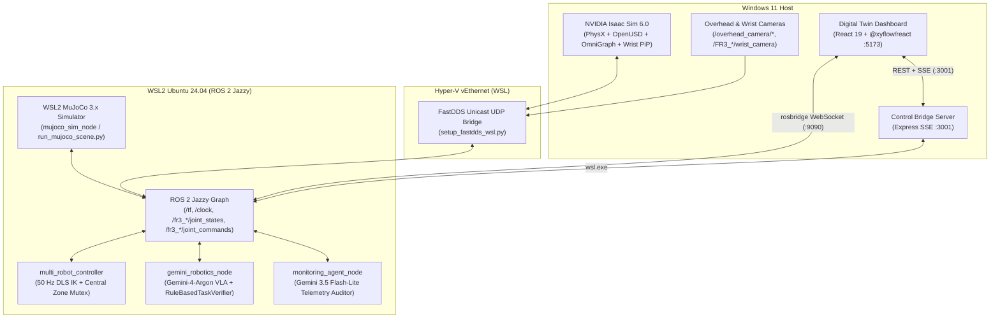

# IsaacSim × MuJoCo × ROS 2 Jazzy × Gemini-4-Argon — Multi-Robot Physical AI Framework

[](https://docs.ros.org/en/jazzy/)
[](https://developer.nvidia.com/isaac-sim)
[](https://mujoco.org/)
[](https://deepmind.google/technologies/gemini/)
[](https://react.dev/)
[](https://reactflow.dev/)
[](LICENSE)

A cross-OS Physical AI and multi-robot manipulation framework connecting **NVIDIA Isaac Sim 6.0** (Windows 11 host) and **MuJoCo 3.x** (WSL2 Ubuntu 24.04) with **ROS 2 Jazzy Jalisco**, **Google Gemini-4-Argon / 3.5 Flash-Lite**, and a **React 19 + `@xyflow/react` v12 Digital Twin** over a **FastDDS Unicast Bridge**.

<div align="center">
  
</div>

---

## Project History, Open-Source Scope & TAMP Research Contact

> **Started in May 2026 — Clean Open-Source Infrastructure Release**:
> This project has been under active development since **May 2026**. To publish a clean, self-contained, and reproducible reference for the Physical AI community while protecting ongoing research contributions, the git commit history was intentionally reset into a single initial release commit.
>
> - **Public Open-Source Scope (4 Core Pillars)**: Shares the end-to-end **Isaac Sim (Windows) / MuJoCo 3.x (WSL2) ↔ FastDDS Unicast ↔ ROS 2 Jazzy (WSL2) ↔ Gemini-4-Argon API ↔ React 19 Digital Twin** integration outline, 50 Hz Damped Least Squares (DLS) kinematic controllers, safety verifiers, and baseline multi-robot workcell scenes (**Mode 1** & **Mode 4**), with zero API keys or proprietary datasets.
> - **Confidential Research Scope (`private/research/`)**: Advanced multi-robot collaboration scenes, closed-chain bimanual & dynamic conveyor controllers (**Mode 2**), deformable object manipulation & long-horizon **Agentic Task and Motion Planning (TAMP / ATAMP)** algorithms, formal pre-execution safety shields, contention-aware wavefront schedulers, and benchmark datasets (**Mode 3**) are maintained inside the gitignored `private/research/` directory.
>
> **Interested in Learning Task & Motion Planning (TAMP) Based on This Repository?**
> If you want to learn more about our Task & Motion Planning architecture, multi-robot collaboration, or research benchmarks:
> - **Open a GitHub Issue** on this repository, or
> - **Contact the author via**: **[https://mincasurong.github.io](https://mincasurong.github.io)**

---

## Core Open-Source Pillars

| Pillar | Directory / Key Files | Role & Explanation |
|:---|:---|:---|
| **1. Cross-OS FastDDS Unicast Bridge** | `scripts/setup_fastdds_wsl.py`<br/>`scripts/fastdds_watchdog.py`<br/>`scripts/launcher.bat` | Hyper-V `vEthernet (WSL)` virtual switches block UDP multicast discovery by default. `setup_fastdds_wsl.py` auto-detects the live Windows host and WSL2 IPv4 addresses and generates matched FastDDS unicast `<initialPeersList>` XML profiles (`RMW_IMPLEMENTATION=rmw_fastrtps_cpp`) so Windows and WSL2 share a unified ROS 2 graph. |
| **2. React 19 + `@xyflow/react` Digital Twin** | `gemini_web_gui/src/App.tsx`<br/>`gemini_web_gui/src/components/VisualWorkflowBuilder.tsx`<br/>`gemini_web_gui/server.cjs` | Full-stack web control station (`:5173` Vite UI + `:3001` Express SSE server + `:9090` `rosbridge_websocket`). Supports both **Zero-Token Visual Flow DAG** authoring/execution and **Autonomous Gemini VLA** orchestration with live 2D/3D `/tf` workspace projection, multi-arm Gantt timelines, and AI telemetry/cost monitoring. |
| **3. NVIDIA Isaac Sim 6.0 OpenUSD Scenes** | `isaacsim_scripts/three_robot_tower.py`<br/>`isaacsim_scripts/single_arm_manipulator.py`<br/>`isaacsim_scripts/run_industrial_mobile_manipulator.py` | Standalone OpenUSD scenes featuring 3x Franka Emika FR3 manipulators, eye-in-hand wrist cameras with low-latency Picture-in-Picture (PiP) viewports, overhead RGB-D sensors, DLSS Performance tuning, and OmniGraph ROS 2 `/clock`, `/tf`, and `/fr3_*/joint_states` bridges. |
| **4. WSL2 MuJoCo 3.x ↔ ROS 2 ↔ Gemini API Bridge** | `wsl_ws/launcher_mujoco.sh`<br/>`wsl_ws/mujoco_ws/run_mujoco_scene.py`<br/>`wsl_ws/src/isaac_ros2_control/` | Lightweight (`<0.1s` startup) WSL2-native MuJoCo 3.x simulator (`mujoco_sim_node.py`, `mujoco_env.py`) using authentic Franka FR3 3D STL collision meshes (`gravcomp="1"`), paired with the 50 Hz 7-DOF DLS IK controller (`kinematics.py`, `multi_robot_controller.py`), `RuleBasedTaskVerifier`, and `GeminiRoboticsNode` (`google-genai`). |

---

## Workcell Modes & Research Tiers (`scripts/launcher.bat` & `wsl_ws/launcher_mujoco.sh`)

| Mode | Launcher Option | Target Domain & Purpose | Availability |
|:---:|---|---|---|
| **Mode 1** | `1) Three FR3 Robot Tower` | **Core Integration Outline (`Isaac Sim / MuJoCo ↔ ROS 2 WSL2 ↔ Gemini-4-Argon`)**: Tests the foundational cross-OS FastDDS bridge, 50 Hz DLS IK controller, central workspace mutex (`center_occupied_by`), and 3-arm cooperative tower stacking / cross-table staging relays. | **Public Open-Source** (`isaacsim_scripts/three_robot_tower.py` & `mujoco_env.py`) |
| **Mode 2** | `2) Dual FR3 Collaboration` | **Challenging Multi-Robot Collaboration & Dynamic Manipulation**: Tests synchronized dual-arm closed-chain `LongBar` (0.8 m) lifting, parametric SE(3) circular wave motion (`dual_arm_circle`), and dynamic moving-conveyor pick-and-place (`Flying Grasp`). | **MuJoCo Bridge Public** (`mujoco_env.py`); **Full Research Scene in `private/research/`** |
| **Mode 3** | `3) Deformable & Long-Horizon TAMP` | **ATAMP & Collaborative Deformable Manipulation Research**: Tests single-arm and dual-arm collaborative deformable object manipulation (handover, cloth unfolding, garment/laundry folding), pre-flight safety shielding, and closed-loop fault recovery. | **MuJoCo Bridge Public** (`mujoco_env.py`); **Full Research Suite in `private/research/`** |
| **Mode 4** | `4) Mobile Manipulator` | **Industrial Mobile Manipulation**: Composes a differential-drive mobile base (`Nova Carter`) with a 7-DOF Franka FR3 arm in a warehouse environment. | **Public Open-Source** (`isaacsim_scripts/run_industrial_mobile_manipulator.py`) |

---

## System Architecture



---

## Core Capabilities Explained

1. **Cross-OS FastDDS Unicast Bridge (`scripts/setup_fastdds_wsl.py`)**:
   - Automatically discovers the current WSL2 guest IP and Windows Hyper-V `vEthernet (WSL)` gateway IP on every boot and writes synchronized `fastdds_profile.xml` files across Windows and WSL2.
   - Includes a heartbeat watchdog (`scripts/fastdds_watchdog.py`) to monitor `/clock` and `/tf` continuity across the OS boundary.
2. **Dual Simulator Backend (NVIDIA Isaac Sim 6.0 or WSL2-Native MuJoCo 3.x)**:
   - **Isaac Sim 6.0 (Windows)**: High-fidelity RTX rendering, OpenUSD scenes, eye-in-hand wrist camera Picture-in-Picture (PiP), and PhysX 5 articulation controllers via OmniGraph.
   - **MuJoCo 3.x (WSL2 Ubuntu 24.04)**: Ultra-fast (`2500+ Hz`, `<0.1s` cold start) WSL2-native physics engine with authentic Franka Emika FR3 STL meshes, gravity compensation, and LIBERO BDDL / `robomimic` dataset export—publishing the **exact same ROS 2 topics** (`/clock`, `/tf`, `/fr3_{1..3}/joint_states`, `/fr3_{1..3}/joint_commands`, `/reset_simulation`) as Isaac Sim.
3. **Dual Execution Engine (Zero-Token DAG vs. Autonomous Gemini VLA)**:
   - **Visual Flow Mode (Zero-Token DAG)**: Interactive `@xyflow/react` v12 node editor that dispatches parallel and sequential robot primitives (`pick`, `place`, `place_relative`, `dual_arm_pick`, `dual_arm_circle`, `dual_arm_place`, `go_home`) directly over `rosbridge_websocket` (`:9090`) with **zero LLM token cost**.
   - **Autonomous VLA Mode (`Gemini-4-Argon` + `Gemini 3.5 Flash-Lite`)**: Hierarchical multi-turn vision-language-action planning grounded by live 3D `/tf` poses and verified before execution by `RuleBasedTaskVerifier` (reachability bounds, collision zones, and bimanual promotion guardrails).
4. **50 Hz Multi-Arm Control & Central Zone Mutex (`multi_robot_controller.py`, `kinematics.py`)**:
   - Analytical forward kinematics from the Franka FR3 Modified Denavit-Hartenberg (MDH) chain and 50 Hz Damped Least Squares (DLS) 7-DOF Inverse Kinematics with joint-limit clamping, null-space posture projection, and SLERP orientation interpolation.
   - Enforces a deterministic `center_occupied_by` mutex lock over the shared central stacking table ($R < 0.25\text{ m}$) so non-holding arms wait at safe hover waypoints while another arm places and retracts.
5. **Real-Time Web Digital Twin (`gemini_web_gui/`)**:
   - Live 2D/3D `/tf` workspace projection, multi-arm Gantt execution timeline, AI model token/latency/cost comparison monitor, and one-click process orchestration (`▶ Start`, `■ Stop`, `↺ Reset`).

---

## Repository Structure

```text
IsaacSim_GeminiRobotics/
├── .env.example                 # Environment template (copy to private/.env for GEMINI_API_KEY)
├── fastdds_profile.xml          # Generated FastDDS unicast locator config (Windows <-> WSL2)
├── scripts/
│   ├── setup_fastdds_wsl.py     # Auto-detects Windows/WSL2 IPs & writes FastDDS XML profiles
│   ├── fastdds_watchdog.py      # Monitors cross-OS /clock & /tf discovery health
│   ├── pre_commit_sanitize.py   # Pre-commit scanner blocking API keys & local paths
│   ├── launcher.bat             # Unified Windows menu launcher (Isaac Sim / MuJoCo / ROS 2)
│   └── start_dashboard.bat      # Starts Express (:3001) + Vite React Digital Twin (:5173)
├── gemini_web_gui/              # React 19 + @xyflow/react v12 Digital Twin & Express server.cjs
├── isaacsim_scripts/            # NVIDIA Isaac Sim 6.0 standalone OpenUSD scenes
│   ├── three_robot_tower.py     # Mode 1: 3-Arm Franka FR3 tower station + OmniGraph ROS 2 bridge
│   ├── single_arm_manipulator.py
│   ├── assemble_industrial_mobile_manipulator.py
│   └── run_industrial_mobile_manipulator.py
├── wsl_ws/                      # WSL2 Ubuntu 24.04 ROS 2 Jazzy workspace & MuJoCo bridge
│   ├── bringup.bash             # Syncs wsl_ws/src -> ~/catkin_ws & launches ROS 2 + rosbridge
│   ├── launcher_mujoco.sh       # Launches WSL2-native MuJoCo 3.x + ROS 2 + Gemini VLA
│   ├── setup_all.sh             # Automated WSL2 ROS 2 Jazzy provisioning script
│   ├── mujoco_ws/
│   │   └── run_mujoco_scene.py  # Standalone MuJoCo 3.x FR3 workcell & closed-loop runner
│   └── src/
│       ├── isaac_ros2_control/  # 50 Hz DLS IK, mujoco_sim_node, mujoco_env, Gemini VLA, verifier
│       ├── multi_robot_description/
│       └── multi_robot_moveit_config/
└── docs/                        # Quickstart, development, and contributor guides
```

---

## Quick Start

### 1. Prerequisites
- **Windows 10/11** with **WSL2 (Ubuntu 24.04 LTS)**
- **ROS 2 Jazzy Jalisco** (installed inside WSL2 via `wsl_ws/setup_all.sh`)
- **Node.js 18+** (for the React 19 Digital Twin dashboard)
- **Simulator (Choose One or Both)**:
  - **WSL2 MuJoCo 3.x** (runs natively inside WSL2 on CPU/WSLg; no heavy GPU required), and/or
  - **NVIDIA Isaac Sim 6.0** on Windows (requires an NVIDIA RTX GPU with 8 GB+ VRAM)

### 2. Provision WSL2 & ROS 2 Jazzy
Open your WSL2 `Ubuntu-24.04` terminal:
```bash
cd wsl_ws
chmod +x setup_all.sh
./setup_all.sh
```

### 3. Configure Environment Variables (API Key Never Committed to Git)
From the repository root:
```bash
mkdir -p private
cp .env.example private/.env
```
Edit `private/.env` with your [Google AI Studio API key](https://aistudio.google.com/apikey):
```env
GEMINI_API_KEY=your_gemini_api_key_here
PLANNER_MODEL=gemini-3.5-flash-lite
ROBOTICS_MODEL=gemini-4-argon
MONITORING_MODEL=gemini-3.5-flash-lite
EXECUTION_MODE=visual_flow
```

### 4. Generate FastDDS Unicast Profiles & Build ROS 2 Package
```powershell
# On Windows (refresh FastDDS Unicast IPs after any Windows/WSL2 reboot):
python scripts\setup_fastdds_wsl.py

# Build the ROS 2 package inside WSL2:
wsl -d Ubuntu-24.04 bash -c "cd ~/catkin_ws && source /opt/ros/jazzy/setup.bash && colcon build --symlink-install --packages-select isaac_ros2_control"
```

### 5. Build the Digital Twin Dashboard
```bash
cd gemini_web_gui
npm install
npm run build
```

---

## Launching the Platform

### Workflow A: WSL2-Native MuJoCo 3.x + ROS 2 + Gemini VLA + Web GUI
Use this lightweight workflow to run the full 3D Franka FR3 simulation, ROS 2 controllers, Gemini VLA, and Web GUI without launching Isaac Sim on Windows:

1. **Launch the WSL2 MuJoCo Workcell + ROS 2 Stack**:
   ```bash
   # Interactive menu in WSL2 (select Mode 1, 2, or 3):
   bash wsl_ws/launcher_mujoco.sh

   # Or launch Mode 1 (3-Robot FR3 Tower + ROS 2 + rosbridge :9090) directly:
   bash wsl_ws/launcher_mujoco.sh 1
   ```
   *(Tip: To open only the MuJoCo 3D viewer + ROS 2 bridge and start the controllers from the Web GUI `▶ Start` button, run `bash ~/mujoco_ws/launcher_mujoco.sh 4 1`.)*
2. **Start the Web Digital Twin Dashboard (Windows)**:
   ```cmd
   scripts\start_dashboard.bat
   ```
   Open **`http://localhost:5173`** in your browser.

### Workflow B: NVIDIA Isaac Sim 6.0 (Windows) + ROS 2 (WSL2) + Web GUI
1. **Start Isaac Sim & FastDDS Bridge (Windows)**:
   Run `scripts\launcher.bat` and select:
   - `[1]` **Mode 1: Three FR3 Robot Tower** (`isaacsim_scripts/three_robot_tower.py`)
   - `[2]` **Mode 2: Dual FR3 Collaboration** (requires `private/research/` or runs in MuJoCo)
   - `[3]` **Mode 3: Deformable & Long-Horizon TAMP** (requires `private/research/` or runs in MuJoCo)
   - `[4]` **Mode 4: Industrial Mobile Manipulator Demo** (Nova Carter + FR3)
2. **Start ROS 2 Control & VLA Stack (WSL2)** *(if not auto-started by launcher)*:
   ```bash
   cd ~/catkin_ws
   bash bringup.bash
   ```
3. **Open the Web Digital Twin**:
   Run `scripts\start_dashboard.bat` and open **`http://localhost:5173`**.

---

## Verification & Unit Tests

Run the offline kinematics, MuJoCo environment, and safety verifier unit tests:
```bash
pytest wsl_ws/src/isaac_ros2_control/test/ -v
```

Run the pre-commit sanitizer to verify zero API keys or local machine path leaks:
```bash
python scripts/pre_commit_sanitize.py README.md
```

---

## Troubleshooting

- **ROS 2 topics not visible between Windows and WSL2**:
  1. Re-run `python scripts/setup_fastdds_wsl.py` to refresh the WSL2 and Windows Hyper-V gateway IPs in `~/fastdds_profile.xml` and `%USERPROFILE%\fastdds_profile.xml`.
  2. Run Option `[6]` in `scripts\launcher.bat` as Administrator to allow inbound UDP traffic on `vEthernet (WSL)`.
- **`TF_OLD_DATA` or frozen arm joints**:
  Ensure no orphaned Isaac Sim processes are publishing competing `/clock` timestamps:
  ```powershell
  Stop-Process -Name "kit" -Force -ErrorAction SilentlyContinue
  ```

---

## Documentation & Contact

- [Quick Start Guide](docs/QUICKSTART.md)
- [Architecture & Development Guide](docs/DEVELOPMENT.md)
- [Contributing Guidelines](docs/CONTRIBUTING.md)
- [Changelog](docs/CHANGELOG.md)
- **Task & Motion Planning (TAMP) Inquiries**: Open a **GitHub Issue** on this repository or contact **[https://mincasurong.github.io](https://mincasurong.github.io)**.

## License

Licensed under the [Apache License 2.0](LICENSE).
