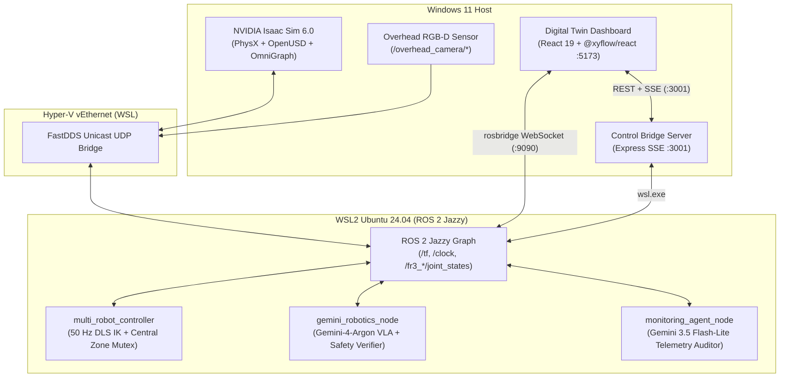

# IsaacSim × ROS 2 Jazzy × Gemini-4-Argon — Multi-Robot Physical AI Framework

[](https://docs.ros.org/en/jazzy/)
[](https://developer.nvidia.com/isaac-sim)
[](https://deepmind.google/technologies/gemini/)
[](https://react.dev/)
[](https://reactflow.dev/)
[](LICENSE)

A cross-OS Physical AI and multi-robot manipulation framework connecting **NVIDIA Isaac Sim 6.0** (Windows 11 host), **ROS 2 Jazzy Jalisco** (WSL2 Ubuntu 24.04), **Google Gemini-4-Argon / 3.5 Flash-Lite**, and a **React 19 + `@xyflow/react` v12 Digital Twin** over **FastDDS Unicast**.

<div align="center">
  
</div>

---

## Project History & Confidential Open-Source Notice

> **Started in May 2026 — Confidential Open-Source Release**:
> This project has been under active development since **May 2026**. To publish a clean, reproducible **confidential open-source** reference for the community while protecting ongoing research contributions, the previous commit history was intentionally deleted/reset into a single initial release commit.
>
> - **Public Open-Source Scope**: Shares the end-to-end **Isaac Sim (Windows) <-> FastDDS Unicast <-> ROS 2 Jazzy (WSL2) <-> Gemini-4-Argon / React 19 Digital Twin** integration outline, kinematic controllers, and baseline multi-robot station (**Mode 1** & **Mode 4**).
> - **Confidential Research Scope (`private/`)**: Advanced multi-robot collaboration scenes, closed-chain bimanual & dynamic conveyor controllers (**Mode 2**), long-horizon **Agentic Task and Motion Planning (ATAMP)** research algorithms, formal safety shields, wavefront schedulers, and LaTeX evaluation suites (**Mode 3**) are maintained inside the gitignored `private/` directory and are **not opened to individuals**.

---

## Workcell Modes & Research Tiers (`scripts/launcher.bat`)

| Mode | Launcher Option | Target Domain & Purpose | Availability |
|:---:|---|---|---|
| **Mode 1** | `1) Three FR3 Robot Tower` | **Core Integration Outline (`Isaac Sim <-> ROS 2 WSL2 <-> Gemini-4-Argon`)**: Tests the foundational cross-OS FastDDS bridge, 50 Hz DLS IK controller, central workspace mutex (`center_occupied_by`), and 3-arm cooperative tower stacking / cross-table staging relays. | **Public Open-Source** (`isaacsim_scripts/three_robot_tower.py`) |
| **Mode 2** | `2) Dual FR3 Collaboration` | **Challenging Multi-Robot Collaboration & Dynamic Manipulation**: Tests synchronized dual-arm closed-chain `LongBar` (0.8m) lifting, parametric SE(3) circular wave motion (`dual_arm_circle`), and dynamic moving-conveyor pick-and-place (`Flying Grasp`). | **Confidential (`private/research/`)** |
| **Mode 3** | `3) Long-Horizon Assembly` | **ATAMP (Agentic Task and Motion Planning) Research**: Tests long-horizon cooperative sub-assembly, contention-aware wavefront scheduling, pre-flight safety shielding, and local subgraph fault recovery. | **Confidential (`private/research/`)** |
| **Mode 4** | `4) Mobile Manipulator` | **Industrial Mobile Manipulation**: Composes a differential-drive mobile base (`Nova Carter`) with a 7-DOF Franka FR3 arm in a warehouse environment. | **Public Open-Source** (`isaacsim_scripts/run_industrial_mobile_manipulator.py`) |

---

## System Architecture



---

## Core Capabilities

1. **Cross-OS FastDDS Unicast Bridge**: Automatic IP discovery (`scripts/setup_fastdds_wsl.py`) generating matched FastDDS unicast locator profiles between Windows and WSL2.
2. **Dual Execution Engine**:
   - **Visual Flow Mode (Zero-Token DAG)**: Interactive `@xyflow/react` v12 node editor that dispatches parallel and sequential robot primitives over `rosbridge_websocket` with zero LLM token cost.
   - **Autonomous VLA Mode (`Gemini-4-Argon`)**: Multi-turn vision-language-action reasoning with function calling (`pick`, `place`, `place_relative`, `dual_arm_pick`, `dual_arm_circle`, `dual_arm_place`, `go_home`, `verify_tower`) grounded by real-time 3D `/tf` poses and guarded by `RuleBasedTaskVerifier`.
3. **50 Hz Multi-Arm Control & Mutex Arbitration**: Damped Least Squares (DLS) 7-DOF Inverse Kinematics with joint-limit clamping, null-space posture projection, SLERP orientation interpolation, and central workspace mutual exclusion.
4. **Real-Time Web Digital Twin (`gemini_web_gui`)**: Live 2D/3D TF workspace projection, multi-arm Gantt timeline, event trace exporter, and process orchestration dashboard.

---

## Quick Start

### 1. Prerequisites
- **Windows 10/11** with **WSL2 (Ubuntu 24.04 LTS)**
- **NVIDIA RTX GPU** (8 GB+ VRAM) with **NVIDIA Isaac Sim 6.0** (or 4.5+)
- **ROS 2 Jazzy Jalisco** (installed inside WSL2 via `wsl_ws/setup_all.sh`)
- **Node.js 18+** (for the web dashboard)

### 2. Provision WSL2 & ROS 2 Jazzy
Open your WSL2 Ubuntu-24.04 terminal:
```bash
cd wsl_ws
chmod +x setup_all.sh
./setup_all.sh
```

### 3. Configure Environment Variables
From the repository root:
```bash
cp .env.example private/.env
```
Edit `private/.env` with your [Google AI Studio API key](https://aistudio.google.com/apikey):
```env
GEMINI_API_KEY=your_gemini_api_key_here
PLANNER_MODEL=gemini-3.5-flash-lite
ROBOTICS_MODEL=gemini-4-argon
MONITORING_MODEL=gemini-3.5-flash-lite
EXECUTION_MODE=visual_flow
```

### 4. Build the Digital Twin Dashboard
```bash
cd gemini_web_gui
npm install
npm run build
```

### 5. Launch Simulation, ROS 2 & Dashboard
1. **Generate FastDDS Unicast Profiles & Start Isaac Sim (Windows)**:
   Run `scripts\launcher.bat` and select:
   - `[1]` **Mode 1: Three FR3 Robot Tower** (Isaac Sim <-> ROS 2 WSL2 <-> Gemini outline)
   - `[2]` **Mode 2: Dual FR3 Collaboration** (LongBar lifting & conveyor pick-and-place; requires `private/research/`)
   - `[3]` **Mode 3: Long-Horizon Assembly** (ATAMP research; requires `private/research/`)
   - `[4]` **Mode 4: Industrial Mobile Manipulator Demo** (Nova Carter + FR3)
2. **Start ROS 2 Control & VLA Stack (WSL2)**:
   ```bash
   cd ~/catkin_ws
   bash bringup.bash
   ```
3. **Open the Web Digital Twin**:
   Run `scripts\start_dashboard.bat` (or `cd gemini_web_gui && npm run dev` + `node server.cjs`) and open `http://localhost:5173`.

---

## Verification & Unit Tests

Run the offline kinematics and safety verifier test suite in WSL2:
```bash
wsl -d Ubuntu-24.04 bash -c "source /opt/ros/jazzy/setup.bash && pytest wsl_ws/src/isaac_ros2_control/test"
```

---

## Troubleshooting

- **ROS 2 topics not visible between Windows and WSL2**:
  1. Re-run `python scripts/setup_fastdds_wsl.py` to refresh the WSL2 and Windows Hyper-V gateway IPs in `~/fastdds_profile.xml` and `%USERPROFILE%\fastdds_profile.xml`.
  2. Run Option `[6]` in `scripts\launcher.bat` as Administrator to allow inbound UDP traffic on `vEthernet (WSL)`.
- **`TF_OLD_DATA` or frozen arm joints**:
  Ensure no orphaned Isaac Sim processes are publishing competing `/clock` timestamps:
  ```powershell
  Stop-Process -Name "kit" -Force -ErrorAction SilentlyContinue
  ```

---

## Documentation

- [Quick Start Guide](docs/QUICKSTART.md)
- [Architecture & Development Guide](docs/DEVELOPMENT.md)
- [Contributing Guidelines](docs/CONTRIBUTING.md)
- [Changelog](docs/CHANGELOG.md)

## License

Licensed under the [Apache License 2.0](LICENSE).
