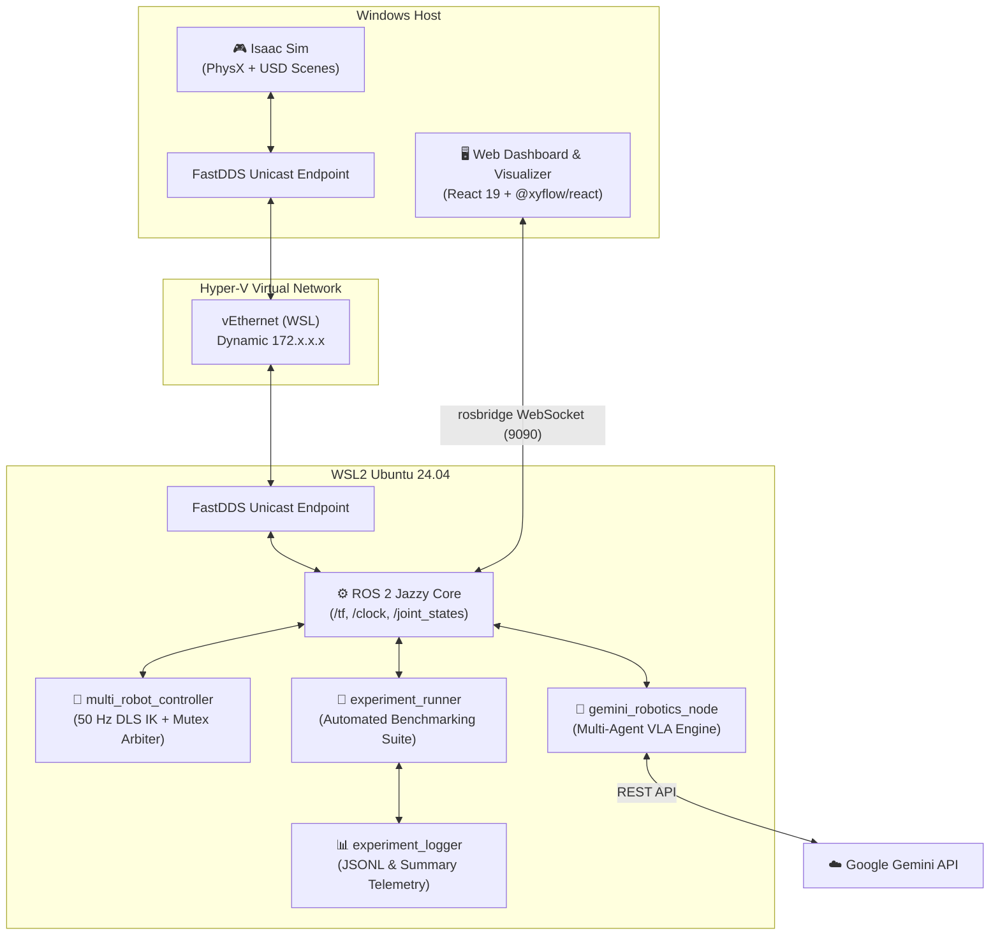
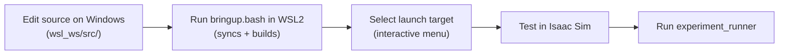

# Development Guide

This guide provides technical details, architectural specifications, and setup workflows for developers and open-source contributors.

---

## 🏗️ System Architecture

The system bridges **NVIDIA Isaac Sim** (Windows) with **ROS 2 Jazzy** (WSL2 Ubuntu 24.04) across a FastDDS Unicast network channel, orchestrating three Franka FR3 robotic arms via Google Gemini-4-Argon and a React 19 digital twin.



### Component Roles & Host Boundaries

| Component | Host / Runtime | Primary Responsibilities |
|---|---|---|
| **Isaac Sim** | Windows 11 | Rigid body physics (PhysX), synthetic sensor generation, overhead RGB-D camera feeds, `/tf` transform broadcasting |
| **multi_robot_controller** | WSL2 (ROS 2) | 50 Hz closed-loop control, Damped Least Squares IK with Null-Space projection, central table mutex lock, trajectory generation |
| **conveyor_dual_controller** | WSL2 (ROS 2) | Dual-arm quintic placement (`DualArmPlaceTrajectory`) and circular wave trajectory strategies (`DualArmCircleTrajectory`) |
| **gemini_robotics_node** | WSL2 (ROS 2) | 4-turn multi-agent brainstorming pipeline, tool schema execution (`pick`, `place`, `place_relative`), closed-loop state tracking |
| **VisualWorkflowBuilder** | Web GUI (React 19) | `@xyflow/react` v12 visual DAG editor with true parallel execution, live parameter selectors, and hardware-in-the-loop verification |
| **workflow_generator** | WSL2 / Python | Synthesizes parallel multi-arm DAG workflow structures from natural language using `gemini-3.5-flash-lite` |
| **feedback_evolution_engine** | WSL2 / Python | Human-in-the-loop diagnostic engine analyzing operator feedback against telemetry to propose parameter and skill tuning |
| **experiment_runner** | WSL2 (ROS 2) | Batch benchmarking execution (S1–S7 scenarios), automated simulation resets, ground-truth TF verification |
| **experiment_logger** | WSL2 (ROS 2) | Captures 35+ metrics across task success, multi-robot coordination (Gini balance), physical accuracy, and VLA throughput |
| **Web Dashboard** | Windows (Browser) | Dual-mode interface (Visual Flow vs Autonomous VLA), 2D digital twin map, Gantt timeline, KPI telemetry, AI Monitor |
| **FastDDS Bridge** | Both | Point-to-point cross-OS DDS discovery and communication via dynamic unicast XML profiles |

---

## 🧠 Three-Tier Multi-Agent Cognitive Architecture

The reasoning engine decomposes natural language instructions into synchronized physical actions through a **4-turn Chain-of-Thought (CoT) multi-agent pipeline** utilizing specialized models:

```mermaid
sequenceDiagram
    autonumber
    actor User as Operator / Web GUI
    participant Node as gemini_robotics_node
    participant Arch as Spatial Architect (📐 Gemini 3.8 Flash)
    participant Opt as Agility Optimizer (⚡)
    participant Orch as Orchestrator (🦾 Gemini-4-Argon)
    participant Audit as Health Auditor (🛡️ Gemini 3.5 Flash-Lite)
    participant Ctrl as multi_robot_controller

    User->>Node: Goal Directive ("Build a 9-layer tower" or "3x3 Grid")
    Note over Node,Arch: Turn 1: Spatial Layout Reasoning & ASCII CoT
    Node->>Arch: Synthesize 2D spatial arrangement
    Arch-->>Node: 2D ASCII Grid + Target Coordinates (X, Y, Z, Yaw)
    Note over Node,Opt: Turn 2: Concurrency & Velocity Optimization
    Node->>Opt: Evaluate concurrency & speed recommendations
    Opt-->>Node: Directive: speed='fast', dispatch parallel arm picks
    Note over Node,Orch: Turn 3: Tool Execution & Physical VLA Dispatch
    Node->>Orch: Generate Function Calling tool calls (pick, place, place_relative)
    Orch->>Ctrl: execute: pick(FR3_1, Block1, fast) + pick(FR3_2, Block4, fast)
    Ctrl-->>Node: Action Results & Gripper Verification
    Note over Node,Audit: Turn 4: Real-Time Diagnostic Audit & Verification
    Node->>Audit: Audit telemetry, joint limits & guardrail events
    Audit-->>Node: Structured JSON Health Assessment (health score, slip alerts)
```

### 1. Spatial Architect (📐) — Powered by Gemini 3.8 Flash
- **Role**: Spatial geometry and arrangement expert.
- **Model**: `PLANNER_MODEL=gemini-3.8-flash`.
- **Reasoning**: Generates a 2D ASCII visual grid representing the target table layout. Maps complex semantic patterns (pyramids, circles, coplanar grids, multi-tower configurations) into millimeter-accurate relative offsets using `place_relative`.

### 2. Agility & Performance Optimizer (⚡)
- **Role**: Task throughput and execution agility optimizer.
- **Reasoning**: Evaluates the physical layout and recommends `speed='fast'` and bold parallel arm dispatches. Because low-level ROS 2 mutex locks (`center_occupied_by`) and singularity-free DLS IK already mathematically guarantee hardware safety, this agent eliminates artificial serialization.

### 3. Orchestrator & VLA Dispatcher (🦾) — Powered by Gemini-4-Argon
- **Role**: Action synthesizer and Function Calling dispatcher.
- **Model**: `ROBOTICS_MODEL=gemini-4-argon`.
- **Reasoning**: Binds spatial plans and speed directives into concrete ROS 2 tool dispatches (`pick`, `place`, `place_relative`, `verify_tower`), monitoring arm states until goal completion.

### 4. Real-Time Diagnostic & Health Auditor (🛡️) — Powered by Gemini 3.5 Flash-Lite
- **Role**: Continuous background telemetry monitoring and anomaly detection.
- **Model**: `MONITORING_MODEL=gemini-3.5-flash-lite`.
- **Reasoning**: Analyzes high-frequency `/rosout` streams, joint tracking errors, pick success rates, and guardrail deny events. Publishes structured JSON health assessments and triggers automatic replanning when deviations occur.

---

## 🔌 Native ROS 2 Model Context Protocol (MCP) Server
A built-in ROS 2 Jazzy MCP server is provided at [`wsl_ws/scripts/ros2_mcp.py`](../wsl_ws/scripts/ros2_mcp.py):
AI coding agents can directly introspect live nodes (`get_node_graph`), inspect sensor feeds (`echo_topic`), and verify Isaac Sim bridge state (`check_isaac_sim_status`).

---

## 🦾 Motion Control & Kinematics

### 50 Hz Control Loop & State Machine
The motion controller executes a 50 Hz state machine per arm:
1. `APPROACH_HOVER`: Move to pre-grasp hover position ($Z = Z_{\text{target}} + 0.12\,\text{m}$).
2. `LOWER`: Descend vertically to target height.
3. `GRIPPER_CLOSE` / `GRIPPER_OPEN`: Trigger gripper actuation with physical touch verification.
4. `LIFT`: Ascend back to clearance height ($Z = 0.35\,\text{m}$).
5. `TRANSPORT`: Transfer to target location.
6. `RETRACT_HOME`: Return to resting home posture.

### Tuned Agile Motion Dynamics
Phase step counts per motion segment:
- **`fast`**: **20 steps** (0.4 s per phase at 50 Hz)
- **`normal`**: **40 steps** (0.8 s per phase at 50 Hz)
- **`slow`**: **70 steps** (1.4 s per phase at 50 Hz)

### Damped Least Squares (DLS) Inverse Kinematics
$$\mathbf{J}^\dagger = \mathbf{J}^T (\mathbf{J} \mathbf{J}^T + \lambda^2 \mathbf{I})^{-1}$$
$$\Delta \mathbf{q} = \mathbf{J}^\dagger \mathbf{e} + (\mathbf{I} - \mathbf{J}^\dagger \mathbf{J}) k_{\text{null}} (\mathbf{q}_{\text{home}} - \mathbf{q})$$

The null-space term keeps joints near their comfortable home configuration while accurately tracking Cartesian end-effector targets, mitigating kinematic singularities and joint limit saturation.

### Workspace Collision Mutex
The central workbench zone is protected by an atomic mutex lock in `multi_robot_controller.py`:
- Before descending into the central target area, a robot arm must acquire `center_occupied_by`.
- If another arm holds the lock, the requesting robot holds in a high-clearance hover state, registering a contention event for telemetry tracking.
- Locks are automatically released when the robot lifts back above clearance height or returns home.

---

## 🛠️ Build & Development Workflow



### Sync & Build Rules
- All source files live in `wsl_ws/src/` on the Windows drive.
- `bringup.bash` in WSL2 syncs from the Windows mount, strips CRLF endings, and builds via `colcon build --symlink-install`.
- **Do not** edit code directly inside `~/catkin_ws/src/` in WSL2, as it is refreshed on each bringup.

### Web Dashboard Build
```bash
cd gemini_web_gui
npm install
npm run build
```
Verify zero TypeScript and Vite bundle errors prior to committing.
